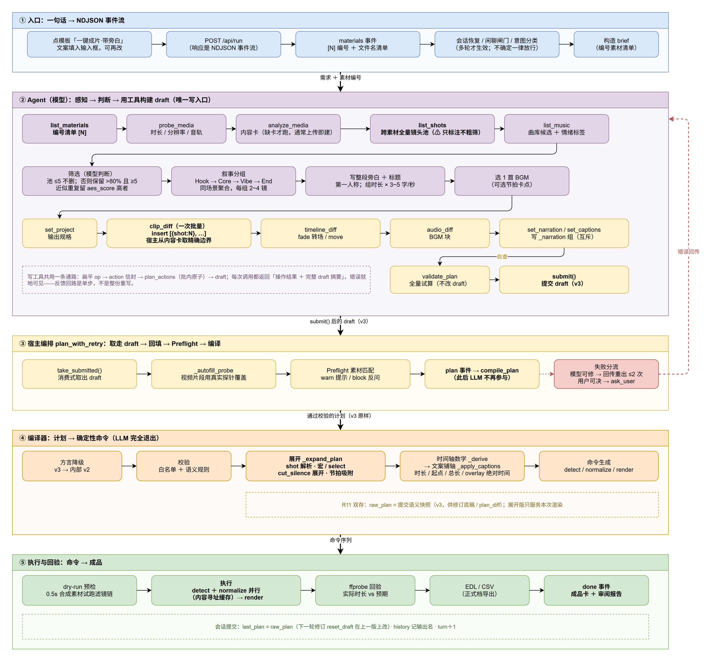
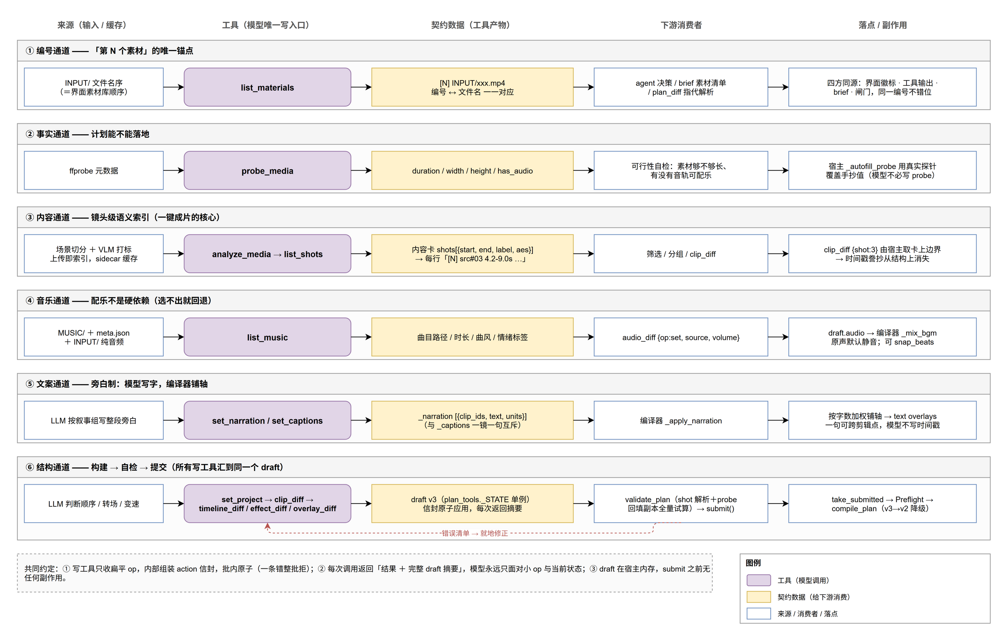
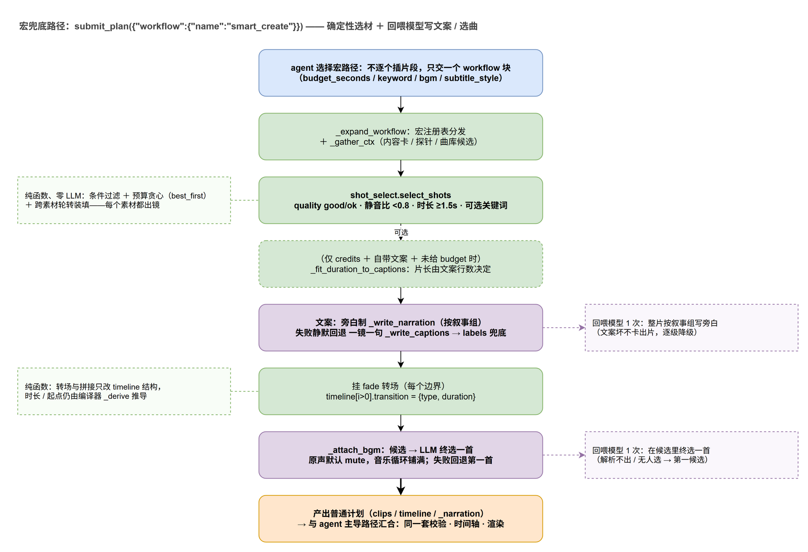

# V12.1 一键成片：从一句话到成片的完整链路（2026-10-29 分支快照）

> 口径：本文描述 **`feat/20261029-intent-material-index` 分支 @ `f906a69`**（2026-10-29 23:36 ～ 10-30 00:12 三个提交）上的实现。
> 与 `main`（`46eae68`）的差异集中在**入口车道**与**素材编号**，创作主链路本身未变。
> 配图：可编辑源与导出一一对应
> - [oneclick-pipeline-flow.drawio](./oneclick-pipeline-flow.drawio) · [PNG](./oneclick-pipeline-flow.drawio.png)
> - [oneclick-tool-contracts.drawio](./oneclick-tool-contracts.drawio) · [PNG](./oneclick-tool-contracts.drawio.png)
> - [oneclick-macro-fallback.drawio](./oneclick-macro-fallback.drawio) · [PNG](./oneclick-macro-fallback.drawio.png)

一句话结论：**一键成片 = 模型当导演、工具当笔、编译器当摄影棚。**
模型只做四件判断（筛哪些镜头、怎么分组、写什么旁白、配哪首曲），
其余全部由确定性代码完成；模型**从不写时间戳、从不写 ffmpeg 命令、从不整份重写计划**。

---

## 0. 结论速览

1. **入口只有一句话**：点「一键成片·带旁白」模板 → `POST /api/run` → NDJSON 事件流。
   首轮没有意图分类（多轮才生效），直接进 agent。
2. **主路径是 agent 逐步构建（V8.0 起，V12 完全工具化）**：感知 5 个工具 → 4 个判断 →
   12 个写/生命周期工具 → `submit()`。共 **19 个工具**（`docs/v12-protocol.md` 记的 18 个
   是 `list_materials` 之前的口径）。
3. **宏路径降为兜底**：`submit_plan({"workflow": {"name": "smart_create", …}})`，
   选材/装填/转场/配乐确定性展开，只把「写文案」「选曲」两次回喂模型。
4. **模型与渲染之间有一道明确边界**：`submit()` 之后 LLM 退出，
   编译器做方言降级 → 校验 → 展开 → 时间轴数学 → 命令 → dry-run → 执行 → 回验。

---

## 1. 两条路径，各自什么时候走

| | ① agent 主导（默认） | ② workflow 宏（兜底） |
|---|---|---|
| 触发 | 用户说「做成一条带旁白的成片 / vlog / 一键成片」 | 「就是拼一下 / 批量参数任务」，或模型认为创作流程不必要 |
| 选材 | 模型看 `list_shots` 全量镜头池自己筛 | `shot_select.select_shots` 条件 + 预算（纯函数） |
| 分组/叙事 | 模型按 Hook→Core→Vibe→End 分组 | 无叙事结构（按 best_first 装填） |
| 文案 | 模型写 `_narration` 组（旁白制） | 编译器回喂模型写（旁白制 → 一镜一句 → labels 兜底） |
| 配乐 | 模型看 `list_music` 自己选 | `_attach_bgm` 候选 + LLM 终选（失败回退第一首） |
| 计划形态 | draft（v3）由 diff 工具构建 | 一个 `workflow` 块，编译器展开成 clips/timeline |
| 下游 | 完全相同：校验 → 编译 → 渲染 → 回验 | 同左 |
| 参考实测 | sim-v12-r1 首轮 289.8s / A1 全素材 307.5s | B1 13.7s |

两条路最终**汇合在同一份普通计划**（clips / timeline / overlays）上，因此
`_expand_plan` 之后的全部逻辑只有一份实现——这是「宏」不会随版本腐化的原因。

---

## 2. 端到端时序（图 1）



### ① 入口（前端 + `web/server.py`）

- 模板文案（`web/static/js/templates.js`）：

  > 帮我把这些素材做成一条带旁白字幕的成片：先看素材内容，按叙事分组挑镜头，
  > 每组写一段第一人称的旁白，配一首合适的曲库音乐，fade 转场，25 秒左右，输出 1080p

- `_run_pipeline` 的第一件事是 `_list_materials()`（**文件名序**），
  再由 `_material_numbers()` 生成 `{文件名: N}`，随 `materials` 事件发给前端。
  这个编号是**全链路唯一锚点**：界面徽标、`list_materials` 输出、brief 素材清单、
  `plan_diff` 的指代解析，四处同源（`web/server.py:216`）。
- 首轮没有 `last_plan`/`turn`，因此**意图分类车道不生效**，直接构造 `messages=None`
  （`plan_with_retry` 内部用 task 单条）。
- 多轮时才有的闸门（本节只列，不展开）：暂存计划确认 > 闲聊闸门 > 状态问句直答 >
  其余一律放行（`web/server.py:685-719`，2026-10-29 改向：`ambiguous` 死胡同已撤销）。

### ② Agent 循环（`video_editing/video_agent.py`）

系统提示词是一份**工作手册**，不是 JSON schema（`V2_SYSTEM_PROMPT_TEMPLATE`，
`video_agent.py:199`）；创作流程段落由 `creative_skills.py` 的
`COMMON_STEPS` 派生注入（`{CREATIVE_DOC}` 占位符），效果清单由 `skills.py` 派生
（`{EFFECTS_DOC}`），宏文档由 `workflow.py` 派生（`{WORKFLOW_DOC}`）——
**提示词与白名单同源，不会脱节**。

模型按八步走（`creative_skills.py:31` 起）：

| 步 | 做什么 | 用到的工具 | 产物 |
|---|---|---|---|
| 1 | 看有哪些素材，读懂「第 N 个」 | `list_materials` | `[N] INPUT/xxx.mp4` 编号清单 |
| 2 | 探测真实时长 / 分辨率 / 音轨 | `probe_media` | probe 事实（可行性自检） |
| 3 | 内容相关任务才建卡（通常上传即建） | `analyze_media` | 内容卡（镜头 + 标签 + 信号） |
| 4 | 拿全量镜头池 | `list_shots` | 每行一个镜头（⚠ 只标注不粗筛） |
| 5 | **筛选**（≤5 不删；否则留 >80% 且 ≥5；近似重复留 aes 高者） | 纯判断 | 入选镜头集合 |
| 6 | **分组叙事**（Hook→Core→Vibe→End，同场景聚合，每组 2~4 镜） | 纯判断 | 有序分组 |
| 7 | **写旁白**（组时长 × 3~5 字/秒，第一人称）+ 标题 | 纯判断 | 每组一段原文 |
| 8 | **选曲** + 用工具把计划搭出来 | `list_music` → `set_project` → `clip_diff` → `timeline_diff` → `audio_diff` → `set_narration` → `validate_plan` → `submit` | draft → 提交 |

关键约束（都写在提示词里，也都在代码里兜底）：

- **`"shot": N` 引用优先**。手抄时间戳是实测第一错误源，宿主从内容卡取精确边界。
- **`clip_diff` 一次批量插入整条序列**，`after` 省略即追加；批内原子。
- **不写 `probe`**：宿主 `_autofill_probe` 用真实探针覆盖。
- **不写时间轴**：没有 `position` 字段，顺序=数组序，时长由编译器推导。
- **改写不重建**：修订轮 draft 已载入上一版，只对要求的部分下 `update/delete`。

### ③ 宿主编排（`plan_with_retry`，`video_agent.py:956`）

```
take_submitted()          ← 消费式取出 submit() 的 draft（v3）
_autofill_probe()         ← 视频片段用真实探针覆盖 clip.probe
check_material_fit_any()  ← Preflight：素材现实 × 计划要求（warn 提示 / block 反问）
plan 事件                 ← 前端流水线区立刻可见
compile_plan(quality=…)   ← 预览档 / 正式档
```

失败按「谁能修」三分流（这是全项目最核心的一条错误设计）：

| 情况 | 处理 | 次数 |
|---|---|---|
| agent 自己 `ask_user` | 直接问用户，**不重试**；半成品 draft 暂存（`hold_draft`） | 1 |
| 素材现实类、用户可决 | 直接问用户（带真实数据与选项），**零重试** | 1 |
| 模型可修（schema / 越界 / 编造 probe） | 错误回传重出 | ≤2 次，**同错熔断** |

### ④ 编译器（`plan_compiler.compile_plan`，`plan_compiler.py:1485`）

```
raw_plan = deepcopy(plan)      ← R11：提交语义快照（v3），供修订底稿 / plan_diff
is_v3 → to_internal()          ← 方言降级 v3→v2，此后管线只有一种形态
validate_plan()                ← 白名单 + 语义规则 + 素材匹配
_expand_plan()                 ← shot 解析 → 宏 / select 展开 → cut_silence 展开 → 节拍吸附
_derive()                      ← 片段时长 / 起点 / 转场重叠后的总长 / overlay 绝对时间
_apply_quality() / _apply_captions() ← 档位改写画布；文案按字数加权铺成 text overlay
_normalize_commands() + render ← 生成命令序列（内容寻址缓存）
```

### ⑤ 执行与回验（`execute` / `verify` / `_execute_compiled`）

1. **dry-run 语法预检**：每条带滤镜的命令先在 0.5s 合成素材上跑一遍（秒级拦坏滤镜）。
2. **执行**：`detect`（人脸打码，OpenCV）与 `normalize`（统一规格 + 逐段控声）并行，
   再 `render`（转场 + 叠加 + BGM 混音 + 按档位编码）。
3. **回验**：ffprobe 实际时长 vs 预期；正式档顺手导出 EDL（CMX3600）/ CSV。
4. **done 事件**：成品卡 + 审阅报告（片段数 / 时长 / 效果 / 转场 / 配乐 / 剪除明细）。
5. **会话提交**：`last_plan = raw_plan`、`history` 记输出名、`turn+1`——
   下一轮修订就在这份 raw 上 `reset_draft`。

**渲染档位**：勾「快速预览」时 `quality="preview"`（短边 540p + ultrafast，
落 `*_preview.mp4`，不覆盖成品）。档位只改编译产物，**不改计划**；归一化缓存分档。

---

## 3. 工具清单（19 个）

装配处：`video_agent.build_video_agent_v2`（`video_agent.py:614`），
`tools=[probe_media, analyze_media, list_materials, list_shots, list_music, submit_plan, ask_user, *PLAN_TOOLS]`。

### A. 感知（5，只读）

| 工具 | 签名 | 返回 | 谁消费 |
|---|---|---|---|
| `list_materials` | `()` | `[N] INPUT/file` 编号清单 | 模型解析「第 N 个素材」 |
| `probe_media` | `(path)` | duration / width / height / fps / has_audio | 可行性自检、裁剪点 |
| `analyze_media` | `(path)` | 内容卡 JSON（shots + label + signals） | `list_shots` / `clip_diff` 的 shot 解析 |
| `list_shots` | `()` | 全量镜头池，一行一镜 | 筛选 / 分组 |
| `list_music` | `()` | 曲目路径 + 标题/曲风/情绪/时长 | 选曲 |

### B. 写入口（8，全部走 action 信封）

| 工具 | 形态 | 落点 |
|---|---|---|
| `set_project` | `(filename, width, height, fps)` | `output`（首轮先初始化 draft） |
| `clip_diff` | `ops[]`: insert / update / delete | `clips`（支持 `shot:N`、`speed`、`volume`、`audio`、`cut_silence`） |
| `effect_diff` | `ops[]`: insert / update / delete | `clips[].effects`（Brightness/Saturation/hflip/…） |
| `overlay_diff` | `ops[]`（text / pip） | `overlays`（按 id 寻址，消灭下标漂移） |
| `timeline_diff` | `ops[]`: move / transition | 片段顺序 + `timeline[].transition` |
| `audio_diff` | `ops[]`: set / clear | 顶层 `audio`（BGM） |
| `set_narration` | `(groups, title)` | `_narration`（旁白组，与 captions 互斥） |
| `set_captions` | `(lines, style)` | `_captions` + `_caption_style` |

### C. 生命周期（4）

| 工具 | 作用 |
|---|---|
| `load_plan` | 整份载入（宿主给计划、或宏产物要手改时） |
| `get_plan` | 打印当前 draft 摘要（片段表 / BGM / 旁白组 / 估算时长 / 上次校验） |
| `validate_plan` | 全量试算（**shot 解析 + probe 回填的副本**，不改 draft） |
| `submit` | 全量校验 → 标记 submitted（宿主 `take_submitted` 取走） |

### D. 出口（2）

| 工具 | 何时用 |
|---|---|
| `ask_user` | 意图含糊 / 素材撑不起 / 缺能力 / 只是想问情况 |
| `submit_plan` | **legacy**：`select` 宏与 `workflow` 宏的唯一提交口 |

> 说明：`select`（批量筛镜头）与 `workflow`（一键成片宏）是模型**唯一手写的计划形态**，
> 因为它们把「时间区间」交给编译器从内容卡确定性生成。

---

## 4. 工具之间怎么配合：六条数据通道（图 2）



把这 19 个工具按「上游喂什么、下游吃什么」拆成六条通道，配合关系就清楚了：

| 通道 | 上游 | 工具 | 契约数据 | 下游消费 |
|---|---|---|---|---|
| ① 编号 | `INPUT/` 文件名序 | `list_materials` | `[N] ↔ 文件名` | 模型决策 / brief / `plan_diff` 闸门 |
| ② 事实 | ffprobe | `probe_media` | 时长 / 分辨率 / 音轨 | 可行性自检；宿主回填 `probe` |
| ③ 内容 | 场景切分 + VLM | `analyze_media` → `list_shots` | 内容卡 `shots[{start,end,label,aes}]` | 筛选 / 分组 / `clip_diff {shot:N}` |
| ④ 音乐 | `MUSIC/` + meta.json + INPUT 音频 | `list_music` | 曲目 + 标签 + 时长 | `audio_diff` → `draft.audio` |
| ⑤ 文案 | 模型判断 | `set_narration` / `set_captions` | `_narration[{clip_ids,text,units}]` | 编译器 `_apply_narration` 铺轴 |
| ⑥ 结构 | 模型判断 | `set_project` → `clip_diff` → `timeline_diff` → `validate_plan` → `submit` | draft v3（`_STATE` 单例） | `plan_with_retry` → `compile_plan` |

**三条共同约定**（这也是「工具化」真正的收益所在）：

1. **批内原子**：一条 op 错，整批拒绝并逐条报错；已成功的部分不需要重做。
2. **每次调用都回摘要**：结果 + 完整 draft 摘要一起返回，模型永远知道当前状态，
   反馈回路是**单步**，不是「提交 → 整份重写」。
3. **draft 在宿主内存**：`submit` 之前无任何副作用；`validate_plan` 用副本试算，
   所以「试算失败」不污染草稿。

再补三条容易忽略的联动：

- **`shot:N` 是跨工具契约**：`list_shots` 给出编号与边界，`clip_diff` 只收编号，
  宿主 `_shot_span()` 回查内容卡取 `start/end`；编译器 `_resolve_shot_refs()` 再解析一次
  （防御分支）。同一份内容卡被三个环节读，**模型一次都没抄过时间戳**。
- **`list_materials` 的编号是「外部语言」**：用户说「第 2 个素材」，模型必须用同一套编号
  落到文件，`plan_diff.check_scope` 也要能解析它（否则改写会被误判成全局操作）。
- **宏路径与主路径共用下游**：`submit_plan` 的 `workflow` 块由编译器展开成普通计划，
  之后与 `clip_diff` 产出的计划**没有任何区别**——这就是为什么两条路只需维护一份渲染逻辑。

---

## 5. 一次真实的调用轨迹

来自 V12 实测（`docs/dev-notes-2026-10-28.md`、`docs/v12-protocol.md` 记录的真实 LLM 会话）：

```
list_materials  → probe_media ×N → analyze_media ×M（缺卡的）
→ list_shots（全量池）
→ list_music
→ set_project
→ clip_diff（一次批量 insert，全部用 shot:N）
→ timeline_diff（fade × N-1）
→ audio_diff（BGM，可带 snap_beats）
→ set_narration（按组写旁白 + 标题）
→ validate_plan（自查；有越界就地改）
→ submit
```

- **sim-v12-r1**：一键成片首轮 289.8s 出片（9 片段 / 转场 / BGM / 标题），
  其中两次自纠（BGM 路径猜错 → 重选；overlay 3s 越界 → 改 2.5s 重提）。
- **A1（全素材）**：13 个素材 → 11 片段 + 8 组旁白 + 标题 + 节拍卡点，
  `batch probe(14) → analyze(6) → shot 引用批量插片 → 批量转场 → 旁白 → submit`，
  一次提交零校验错误，38.24s 回验通过。
- **B1（宏路径）**：13.7s 出 28.27s 成片（宏几乎不产生 LLM 轮次）。

耗时结构（`docs/perf-llm-latency-optimization.md`）：TTFT 约 49%、生成 47%、
渲染 3%。**渲染不是瓶颈，模型等首 token 才是**。

---

## 6. 宏兜底路径（图 3）



`smart_create` 的展开顺序（`workflow.py:_expand_smart_create`，`workflow.py:782`）：

1. `_expand_workflow` 分发宏名 + `_gather_ctx` 收集全部内容卡 / 探针 / 曲库候选。
2. `select_shots`：`quality_in ["good","ok"]`、`max_silence_ratio 0.8`、
   `min_duration 1.5s`、可选 `keyword`、`order=best_first`、跨素材轮转装填。
   **注意：V8.0 起宏不再做素材级粗筛**，废信号只在镜头级拒绝。
3. `_fit_duration_to_captions`（仅 credits + 自带文案 + 未给 budget）：片长由文案行数决定。
4. 文案：`_write_narration`（旁白制）→ 失败静默回退 `_write_captions`（一镜一句）
   → `labels` 兜底。提供器链顺序在 `CAPTION_PROVIDERS`，先命中先赢。
5. 每个边界挂 `fade` 转场（`transition` 秒，0=硬切）。
6. `_attach_bgm`：候选（`MUSIC/` 优先 + INPUT 音频）→ LLM 终选 → 回退第一首；
   **有 BGM 就默认静音原声**（`original="mute"`），要保留口播写 `original:"keep"`。
7. 产出普通计划 → 与主路径汇合。

宏路径的取舍：**轮次少（快）、但结构固定（没有叙事分组）**。
所以它现在的定位是「确定性兜底」，不是默认路径。

---

## 7. 这个分支（2026-10-29）改了什么，对一键成片意味着什么

| 提交 | 改动 | 对一键成片的影响 |
|---|---|---|
| `1056595` | 「启动新任务」整区清空 `INPUT/`（白名单降级为 UI 标记） | 新会话不会带上上一轮素材，编号从 #1 重新开始 |
| `2d62a1e` | ① 意图三分类收敛为「状态问句直答，其余放行」；`temperature=0` ② `list_materials` 取代 `ls`；③ 全链路素材编号；④ `plan_diff` 解析「第 N 个」 | 首轮不变；**多轮修订更可靠**（「第二个素材没被用上」这类话不会再被门口吞掉）；编号成为模型与用户之间的公共语言 |
| `f906a69` | 暂存计划确认提到闸门/意图分类之前；有 `pending_question` 时跳过分类 | 「确认全局执行」「选方案 B」不会再被状态直答抢走 |

具体到「一键成片」的可见变化：

- 创作流第 1 步从内置 `ls INPUT/`（裸文件名、无编号）换成 `list_materials`
  （编号清单），`ls` 已进 harness 排除名单（`video_agent.py:605`）。
- `brief` 里的素材清单从顿号裸列表变成编号列表，并注明「第 N 个素材」即指此编号。
- `list_shots` 每行带 `[N]` 前缀——筛选时模型能直接把「第 2 个素材」映射到镜头。
- 工具总数从 18 变 19（`docs/v12-protocol.md` 的清单是 `list_materials` 之前的口径）。

---

## 8. 观测点与已知坑

**怎么观察一轮运行**（`/api/run` 的 NDJSON）：

| 事件 | 含义 |
|---|---|
| `materials` | 素材清单 + `numbers` 编号映射 |
| `attempt` | 第几次尝试（≤3） |
| `llm` | 每次模型输出（含 `tool_calls`，前端渲染成工具轨迹） |
| `analysis` | 感知层进度（建卡） |
| `llm_first_token` | 首 token 到达（区分「挂死」与「生成中」） |
| `plan` / `compile_error` | 计划已通过 Preflight / 校验错误回传 |
| `plan_diff` | 修订轮差异卡（作用域：全部 / 仅 M 片段） |
| `exec_plan` / `math` / `commands` | 展开后的可执行计划 / 时间轴 / 命令序列 |
| `exec` / `verify` / `done` | 逐条执行结果 / 回验 / 成品 + 审阅报告 |

**已知坑（都已在文档留档，未修）**：

- **P-e 首 token 慢**：首轮 `llm_first_token` 累计 141~202s，provider 预填充排队；
  已用「流式 + 60s 首 chunk 闸」把最坏路径从 541s 压到 ~125s，但没消除。
- **内容卡缓存键 = 文件名 + 大小 + mtime**（`content_analysis.py:86`）：
  素材挪动/重新拷贝就会全量重分析（实测 944s），换 content hash 可解，未做。
- **P-d 输出名链式增长**：`-r2-r3-r4` 越来越长（`_guard_overwrite` 每轮追加后缀），
  cosmetic 但对用户不友好。
- **P-b 闸门暂存轮会丢弃该轮全部草稿改动**：用户否掉全局方案时，局部改动也一起丢。
- **工具数已到 19，贴着 function-calling 的软上限（~20）**：V10 曾 25 个（动词式），
  V12 收敛成 18 个（按对象拆 diff），本分支加 `list_materials` 后 19 个；
  目前靠「工具文档即提示词」撑住，再加就要考虑分组或延迟加载。
- **会话只留 5 轮历史**（`SESSION_MAX_TURNS`），超长修订会话会丢早期锚点。
- 旧会话文件（无 `raw_plan` 时代存档的展开版 `last_plan`）不迁移，读到可能熔断。

---

## 9. 关键文件索引

| 关注点 | 文件 |
|---|---|
| 系统提示词 / 创作流八步 / 感知工具 | [`video_editing/video_agent.py`](../video_editing/video_agent.py)（提示词 199 起，工具 400~590，装配 614，`plan_with_retry` 956） |
| 创作 skill 注册表（general/travel/food） | [`video_editing/creative_skills.py`](../video_editing/creative_skills.py) |
| 计划工具面（8 写 + 4 生命周期，共 12） | [`video_editing/plan_tools.py`](../video_editing/plan_tools.py)（`clip_diff` 295，`PLAN_TOOLS` 635） |
| action 信封引擎（批内原子） | [`video_editing/plan_actions.py`](../video_editing/plan_actions.py) |
| v3 ↔ v2 方言层 | [`video_editing/plan_dialect.py`](../video_editing/plan_dialect.py) |
| 编译器（展开 / 数学 / 命令 / 执行 / 回验） | [`video_editing/plan_compiler.py`](../video_editing/plan_compiler.py)（`_expand_plan` 1181，`compile_plan` 1485） |
| 宏（smart_create / one_click_reel / speech_clean） | [`video_editing/workflow.py`](../video_editing/workflow.py)（`_expand_one_click_reel` 420，`_expand_smart_create` 782） |
| 镜头筛选与装填（纯函数） | [`video_editing/shot_select.py`](../video_editing/shot_select.py) |
| 入口 / 事件流 / 会话 / 闸门 | [`web/server.py`](../web/server.py)（`_run_pipeline` 653，`_execute_compiled` 917） |
| 前端模板与素材编号徽标 | [`web/static/js/templates.js`](../web/static/js/templates.js)、[`web/static/js/materials.js`](../web/static/js/materials.js) |
| 协议规范（v3 / action / 工具面） | [`docs/v12-protocol.md`](./v12-protocol.md) |
| 设计动机与实测记录 | [`docs/dev-notes-2026-10-28.md`](./dev-notes-2026-10-28.md)、[`docs/v8.0-agent-workflow.md`](./v8.0-agent-workflow.md)、[`docs/v9.0-understanding-layer.md`](./v9.0-understanding-layer.md) |

---

## 附：一键成片的最短心智模型

```
① 用户说一句 → server 发编号素材清单
② 模型看素材（编号 / 探针 / 内容卡 / 镜头池 / 曲库）
③ 模型做四个判断（筛、分组、写、配）
④ 模型用 diff 工具把判断落成 draft（shot:N，不抄时间戳）
⑤ submit → 宿主回填 + Preflight
⑥ 编译器：降级 → 校验 → 展开 → 数学 → 命令
⑦ 预检 → 并行执行 → ffprobe 回验 → 成品 + 审阅报告
⑧ 会话存 raw_plan —— 下一轮在上一版上改，不重建
```

模型的责任边界就一条：**在 ④ 之前把意图说清楚；④ 之后的一切都不归它管。**
