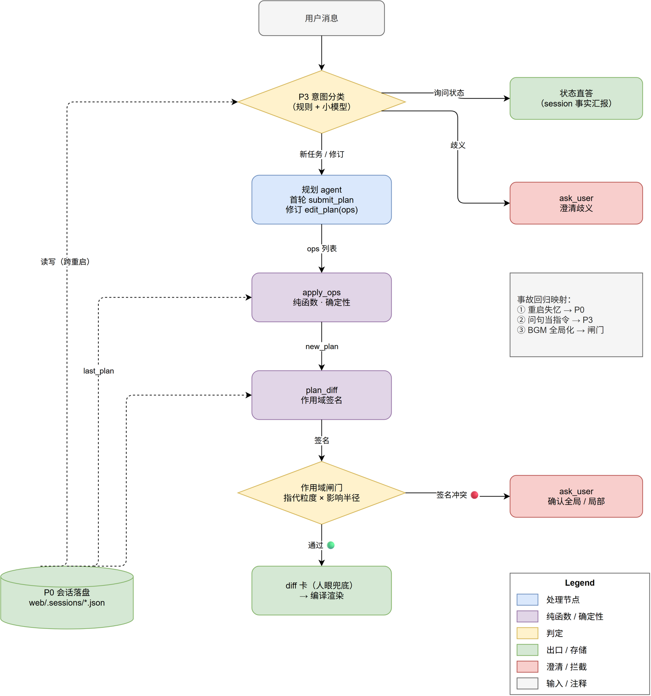
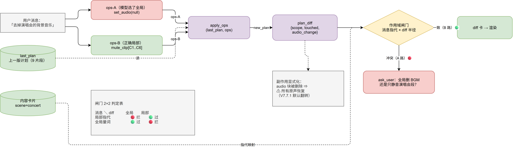

# V9.0 理解层：五层防线

> 状态：已实现（P0–P3）。本文档是设计契约，代码按此实现。
> 起因：2026-10-11 线上三个同日事故——①服务重启丢会话（修订上下文/图片丢失）；
> ②状态问句「你重新剪了嘛」被当修改指令执行；③「去掉演唱会的背景音乐」被
> 理解为全局删除 BGM，且原声默认翻转的副作用未被任何人看见。

## 1. 动机与设计原则

V8 的骨架（计划 → 确定性编译 → 执行）是对的：当天所有事故都在**理解层**，
没有一个在执行层。此前每来一个 case 就补一条提示词——枚举永远追不上表达
的多样性。V9 把「政策」从提示词散文搬进结构里，遵循两条原则：

1. **可计算的校验交给规则**：指代粒度 × 影响半径是纯结构判定，机械可查。
2. **语义的校验交给问句与展示**：不造语义裁判 LLM（LLM-as-judge 只是把
   理解问题挪个位置）。模型可能错，系统的职责是让错误**便宜**：被问清、
   被限定、被看见、被快速重做。

```
P3 事前问（拦歧义/直答状态）
 → P2 ops 强制声明范围（消灭隐式全局）
 → 作用域闸门（拦签名冲突，纯规则）
 → P1 diff 卡（30 秒人眼可见）
 → P0 会话落盘（重做成本 ≈ 一次确认）
```



事故回归映射：① 重启失忆 → P0；② 问句当指令 → P3；③ BGM 全局化 → P2+闸门。

## 2. P0 会话落盘

`web/server.py`：

- `SESSIONS_DIR = web/.sessions/`；每个会话一份 `<sid>.json`（原子写：
  先写 `.tmp` 再 `os.replace`，Windows 下 replace 可覆盖）。
- `_get_session`：内存未命中 → 读盘恢复；仍没有才新建（此时 emit 一条
  status「新会话」，不再静默当第一轮）。
- `_save_session(sid, session)` 在所有状态写入点调用：last_plan / turn /
  pending_question / pending_plan / last_expansions / preview。
- `compiled.expansions` 存入 `session["last_expansions"]`——宏采用率从此
  事后可审计（此前 expansions 只进前端审阅卡即丢）。
- `/api/session/reset` 同时删盘上文件。内存 LRU（≤20）照旧，盘不删
  （文件小，JSON 几 KB；上限 `SESSIONS_MAX_FILES=200` 惰性清理最旧）。
- 会话 JSON 里不含绝对路径与密钥，字段白名单序列化。

## 3. P1 plan_diff + 作用域闸门（新模块 `video_editing/plan_diff.py`）

### 3.1 plan_diff(old, new) -> dict

纯函数，输入两份展开后的计划，输出结构化差异：

```python
{
  "scope": "global" | "local",     # 影响半径
  "touched": ["C3", "C11"],        # 受影响片段 id
  "total_clips": 9,
  "changes": [                      # 人类可读行（diff 卡直接渲染）
    {"kind": "remove_clip", "clip": "C11", "detail": "删除片段（微信视频#2）"},
    {"kind": "audio_block", "detail": "移除全局 BGM",
     "side_effect": "⚠ 所有原声将恢复（V7.7.1 默认翻转）"},
  ],
}
```

判定规则：

- **半径**：顶层块（`audio` / `select` / `workflow` / `output`）增删改，
  或受影响片段 = 全部 → `global`；否则 `local`。
- **片段对齐**：按 `source + trim 区间重叠` 近邻匹配（容忍 trim 微调），
  对不上的算增/删；顺序变化单列。图片/视频一视同仁，删了必出现在
  changes 里。
- **副作用显式化**：`audio` 块有→无 ⇒ 附 `side_effect` 原声恢复提示；
  无→有 ⇒ 原声将被默认静音提示。这是 V7.7.1 编译器默认的「翻译」。

### 3.2 作用域闸门 check_scope(msg, diff, materials, cards) -> dict | None

两个输入均可机械计算：

- **消息指代粒度** `msg_scope`：
  - `local`：含片段 ID（`C\d+`）、素材文件名片段（stem ≥4 字符子串）、
    或内容卡片 scene/activity 标签词（如「演唱会」→ concert）；
  - `global`：含全称量词（全部 / 所有 / 整条 / 每一 / 都）且**无**局部指代；
  - `none`：两者皆无（签名无信息量，放行——设计上接受的残留区）。
- **冲突判定**：`msg_scope=local 且 diff.scope=global` → 拦；
  `msg_scope=global 且 diff.scope=local` → 拦（做少了同样可疑）。
  其余放行。

拦截动作（server 侧）：不渲染，emit `question`（options:
`["确认全局执行", "不，只改我说的那部分", "取消"]`），编译产物暂存
`session["pending_plan"]`。用户答「确认全局」→ 直接执行暂存计划；
其余回答 → 作为新修订要求重新进入规划（`build_answer_brief` 接续）。



### 3.3 明确不管的

范围内目标选错（该静音 C1–C6 却静音了 C7–C8）：两侧都是 local，签名
不冲突，放行——由 diff 卡人眼与 P3 兜。不为这类 case 加规则（会退化
回枚举打地鼠）。

## 4. P2 修订即操作：`edit_plan(ops)`（新模块 `video_editing/plan_ops.py`）

修订轮不再让模型重写整份计划 JSON：

- 新工具 `edit_plan(ops: list[dict])` 加入 agent；`build_revision_brief`
  重写为「只允许 edit_plan，ops 表达不了就 ask_user，不许退回整份重写」。
  （首轮仍用 `submit_plan`；模型若在修订轮仍调 submit_plan，按原路径处理
  ——diff+闸门照常生效，优雅降级。）
- **ops 词汇表（v1，7 个）**：
  `remove_clip(clip)` · `add_clip(source, trim_start?, trim_end?, after?)` ·
  `set_clip_trim(clip, trim_start?, trim_end?)` · `move_clip(clip, after)` ·
  `mute_clip(clip, on=true)` · `set_transition(clip, type?, duration?)` ·
  `set_audio(params | null)`（null = 删 BGM 块，须显式）。
- `apply_ops(last_plan, ops) -> (new_plan, applied, errors)` 纯函数：
  逐 op 校验（clip 必须存在；source 必须在 materials；参数经
  `plan_schema` 同源校验），一个非法 op 全批拒绝（errors 回传重试闭环，
  复用 `plan_with_retry` 的 compile_error 路径）。
- **结构保障免费获得**：ops 没碰的字段逐字节保留（深拷贝后只改目标），
  图片不会悄悄消失；「局部改动放大成全局」在结构上不合法。
- 产出走现有 Preflight → 编译 → 执行管线；P1 的 diff/闸门自动生效。

## 5. P3 意图分类车道（新模块 `video_editing/intent.py`）

仅对**已有会话**（turn ≥ 1 或 pending）的多轮消息启用；首轮消息直通。

- **规则层（零成本，先行）**：问句形态（以 ？/吗/嘛/呢/吧 结尾或含
  「做了吗|有没有|是不是|为什么|怎么样|啥情况|剪好了|完成没」）且不含
  命令式剪辑动词短语 → `status_question`。
- **LLM 层（规则层判 `task` 但置信不高时）**：单次小调用，输出
  `task | question | ambiguous`（JSON 一行；`INTENT_LLM=0` 可关，测试
  离线跑）。规则层判 question 的直接采信，不花这次调用。
- 三条车道：
  - `status_question` → **不进规划 agent**。`build_status_answer(session)`
    从 last_plan / last_output / last_expansions / history 生成事实汇报
    （成片名、片段数、时长、最近一轮用了什么宏、改过什么），emit
    `{"type": "status_answer", "text": ...}`。前端按助手气泡渲染。
    「你重新剪了嘛」从此得到回答而非渲染。
  - `ambiguous` → emit question（options 给典型意图）+ pending_question。
  - `task` → 原路径（P2 ops → diff → 闸门）。

## 6. 前端（web/static/js/app.js）

- `plan_diff` 事件 → 修订轮渲染差异卡（增/删/改行 + 副作用 ⚠ 行 +
    「影响：全部 N 片段 / 仅 M 片段」徽标）。放管线区，不占聊天。
- `status_answer` 事件 → 助手气泡（无 tool_calls）。

## 7. 测试（tests/test_v9_understanding.py，全离线）

1. 会话落盘：写入→清内存（模拟重启）→ 恢复，last_plan/turn/pending 不丢；
   expansions 落盘可读。
2. plan_diff：删片段=local；删 audio 块=global+副作用行；图片删除必报；
   trim 微调不误报增删。
3. 闸门：演唱会案例（msg 局部指代 × diff 全局）→ 拦；全部量词 × local
   → 拦；无签名 → 放行；B2 路（mute_clip 局部）→ 放行。
4. apply_ops：remove_clip 保留其余逐字段不变；未知 clip → errors；
   mute_clip 写入 clips[].audio.mute。
5. intent 规则层：三类样例各 ≥2。
6. 回归：现有 test_v7/v8/v81 全绿。

## 8. 明确不做

- 不改生成路径宏体系；不换 agent 框架；不做 BGM 分段 schema
  （mute_clip 已覆盖真实诉求）；不做语义裁判 LLM；前端不大改。
